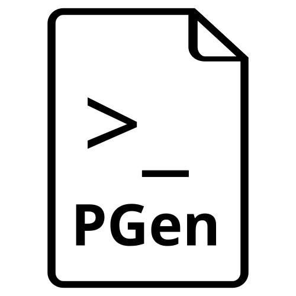

# Print-Gen

<p align="center">
  
</p>


> Design once. Generate hundreds.

A lightweight, browser-based tool for batch-generating PDF pages from spreadsheets.
Lay out a single page, drop in an `.xlsx` or `.csv`, and export every row as its own
PDF page — with images, custom fonts, outlines, and multi-variable text templates.

**No backend. No uploads. No build step. Everything runs in your browser.**

---

## Screenshot


## Table of contents

- [Features](#features)
- [Getting started](#getting-started)
- [Usage](#usage)
- [Placeholder syntax](#placeholder-syntax)
- [Keyboard shortcuts](#keyboard-shortcuts)
- [Project structure](#project-structure)
- [How it works](#how-it-works)
- [Going fully offline](#going-fully-offline)
- [Browser support](#browser-support)
- [Known limitations](#known-limitations)
- [Contributing](#contributing)
- [License](#license)
- [Author](#author)

---

## Features

### Editor

- **Visual canvas** — drag, resize, and delete text boxes, images, and shapes directly on the page.
- **Multi-variable text boxes** — a single text box can mix static text and **any number**
  of `{{ColumnName}}` placeholders. Example:
  `Bonjour {{Prénom}}, votre commande {{Réf}} est prête.`
  Click a column in the sidebar to insert its placeholder at the caret, or append it
  if you're not editing. Columns already used in the selected box are highlighted in teal.
- **Inline text editing** — double-click any text box (field or static) to edit its raw
  template, including `{{ColumnName}}` placeholders. `Esc` or click away to exit.
  Empty boxes are auto-removed.
- **Rich styling** — color, bold, italic, alignment, outline (thickness + color).
- **Images** — resize with aspect-ratio lock (hold `Shift` to distort freely).
- **Shapes** — rectangle, square, triangle, and star, with independent fill color,
  border color, and border width.
- **Z-order** — bring to front / back / move up / down one step.
- **Copy / paste / cut / duplicate** — `Ctrl+C`, `Ctrl+V`, `Ctrl+X`, `Ctrl+D`.
- **RTL support** — automatic Arabic / Hebrew detection, per-box.
- **Zoom** — buttons, `Ctrl/Cmd + scroll` centered on the cursor, fit-to-screen.
- **Dark mode** — respects `prefers-color-scheme` on first run, then remembers your choice.

### Data

- **Excel & CSV import** — drag and drop, or pick a file.
- **Multiple files** — switch between sheets at any time.
- **Row navigation** — preview any record on the canvas with prev/next or click.

### Template storage

- Save the entire layout — objects, positions, styles, images, `{{}}` templates — as a template.
- Reload with one click from the landing page.
- Stored in `localStorage`; nothing is uploaded anywhere.
- Templates saved with older versions (pre-`{{}}` format) are auto-migrated on load.

### Export

- **Per-row PDF pages** — one page per data row.
- **PDF bookmarks** — pick any column to generate one bookmark per page, so the
  reader's outline panel becomes a table of contents.
- **Live progress bar + console** — see each row render with timestamps.
- **Cancellable** — stop mid-export if needed.
- **Quality presets** — Draft / Standard / High, to trade speed against resolution.
- **Auto quality scaling** — resolution is reduced automatically on very large exports
  to keep memory under control.
- **Canvas-2D rendering** — pages are drawn directly to a `<canvas>`, then embedded as JPEG.
  No DOM cloning, no SVG round-trip. 10-50× faster than typical DOM-to-image exports.

---

## Getting started

### Option 1 — Just open it

```bash
git clone https://github.com/hollyenah/print-gen.git
cd print-gen
```

Then open `index.html` in a modern browser (Chrome, Edge, Firefox, Safari).

### Option 2 — Serve locally (recommended for font fidelity)

```bash
# Python 3
python -m http.server 8000
# then visit http://localhost:8000
```

Serving locally avoids some CORS quirks with `file://` URLs when loading Google Fonts.

---

## Usage

1. **Create a canvas** — pick a preset (A4, A3, Letter, 1080p, 720p, Square…) or enter
   your own size in `mm`, `cm`, `in`, `px`, or `pt`.
2. **Add objects**
   - **Text Field** — an empty text box. Double-click to edit; type static text,
     insert `{{ColumnName}}` placeholders, or mix both.
   - **Image** — a picture placed on the page.
   - **Shape** — a rectangle, square, triangle, or star.
3. **Load data** — drop an `.xlsx` / `.csv` anywhere on the editor, or use the
   **+** button in the *Data files* panel.
4. **Insert columns** — select a text box, then click any column in the **left sidebar**.
   The `{{ColumnName}}` placeholder is inserted at the cursor (or appended at the end
   if you're not editing). Columns already present in the selected box are highlighted
   in teal. If no text box is selected, clicking a column creates a new field bound to it.
5. **Style** — pick a font variant, set color, outline, bold/italic, alignment.
6. **Export** — click **Export PDF**. Choose a quality level and, optionally, a column
   to use for PDF bookmarks. Watch the progress bar and console, then download your
   multi-page PDF.

## Keyboard shortcuts

| Action | Shortcut |
| --- | --- |
| Delete selected object | `Del` / `Backspace` |
| Duplicate selected object | `Ctrl/Cmd + D` |
| Copy / Cut / Paste | `Ctrl/Cmd + C` / `X` / `V` |
| Edit text box template | `F2` or double-click |
| Exit inline edit | `Esc` |
| Move object by 1 px | `Arrow keys` |
| Move object by 10 px | `Shift + Arrow keys` |
| Resize with aspect ratio lock | Corner handle (default for images) |
| Resize without aspect ratio | `Shift` + corner handle |
| Zoom in / out | `Ctrl/Cmd + scroll` |
| Deselect / close modal | `Esc` |

---

## Project structure

```text
print-gen/
├── index.html      # Markup — landing screen + editor
├── styles.css      # All styling (light + dark theme)
├── script.js       # Application logic (state, editor, export, templates)
├── LICENSE         # GPL-3.0
├── README.md
└── .gitignore
```

Three source files, zero build step. Edit and refresh.

---

## How it works

### Canvas model

The **page** is a `<div>` sized in CSS pixels. Every object is an absolutely-positioned
`.pg-obj` element. Editing state (`state.boxes`) is the single source of truth; the DOM
is just a projection of it.

### Text templates

Each text box stores a single string (`template`), e.g. `Bonjour {{Prénom}}, votre
commande {{Réf}} est prête.` At render time, `textFor(box)` substitutes every
`{{ColumnName}}` with the current row's value and returns the resolved string, which
is then auto-fitted and drawn.

The **raw template** is shown only while editing (double-click). Everywhere else —
preview, export, saved template — the **resolved text** is what you see.

### Auto-fit text

Each text box finds the largest font size that fits both dimensions:

1. A hidden `<canvas>` measures the widest word at 100 px to establish a hard upper bound.
2. A binary search over font sizes wraps the text using `ctx.measureText` and tests
   whether the wrapped height fits inside the box.
3. The winning size is applied to both the DOM and (later) the export canvas.

This keeps text visually identical between the editor preview and the exported PDF.

### Export pipeline

For each row:

1. Resolve every text box's template against the current row and re-fit the affected boxes.
2. Create an offscreen `<canvas>` at `docWidth × scale`, `docHeight × scale`.
3. Draw the background, then each object in z-order:
   - **Text** — `ctx.fillText` + optional `ctx.strokeText` with round joins.
   - **Images** — `ctx.drawImage` at the box's geometry.
   - **Shapes** — path fill + stroke.
4. Encode as JPEG (`quality: 0.92`), embed into the jsPDF document.

Because everything happens in Canvas 2D, export time scales linearly with rows and
stays well under 100 ms per page for typical layouts.

### PDF bookmarks

When exporting, you can select a column from the spreadsheet to generate one PDF
bookmark per page. This turns the outline panel of any PDF reader into a clickable
table of contents — very useful when the file has hundreds of pages.

Bookmarks are written natively into the PDF structure (no JavaScript, no external
metadata), so they work in every standard reader: Chrome, Firefox, Adobe Reader,
Preview, Okular, etc.

Leave the field on **None** to export without bookmarks.

### Templates

Saved as JSON in `localStorage`. Images are inlined as data URLs, so a template with
a large photo can get big — but it works completely offline and survives page reloads.

Older templates saved before the `{{ColumnName}}` rewrite (using the legacy
`colKey` / `staticText` fields) are automatically migrated to the new template
format the first time they are loaded.

---

## Going fully offline

By default, two libraries are loaded from CDNs:

| Library | Purpose |
| --- | --- |
| [SheetJS](https://sheetjs.com/) (`xlsx.full.min.js`) | Parse `.xlsx` / `.csv` files |
| [jsPDF](https://github.com/parallax/jsPDF) (`jspdf.umd.min.js`) | Build the output PDF |

To remove the network dependency:

1. Download each `.min.js` file into a `vendor/` folder.
2. In `index.html`, replace the two `<script src="https://...">` tags with local paths:

   ```html
   <script src="vendor/xlsx.full.min.js"></script>
   <script src="vendor/jspdf.umd.min.js"></script>
   ```

For **identical font rendering** offline, download the `.woff2` files for the fonts
you use (Google Fonts) and self-host them. Fonts are measured against the browser's
text engine during layout, so the local rendering must match what you expect in
the final file.

---

## Browser support

| Browser | Status |
| --- | --- |
| Chrome / Edge (Chromium) | ✅ Tested |
| Firefox | ✅ Tested |
| Safari | ✅ Works — Canvas 2D text is fully supported |
| Mobile | ❌ Not designed for touch |

---

## Known limitations

- Very large images embedded in templates may exceed `localStorage`'s ~5 MB quota.
  If that happens, remove the image or use smaller source files.
- Arabic / RTL shaping depends on the browser's text engine; results may vary on
  older Safari versions.
- Export is raster-based (JPEG), not vector. Text is not selectable in the generated PDF.
- `{{ }}` is reserved syntax. There is currently no escape sequence to print literal
  `{{` or `}}` in a text box — use a dummy column if you really need them.
- Google Fonts are loaded from the CDN by default — see [Going fully offline](#going-fully-offline)
  if you need a zero-network setup.
- Templates saved with versions ≤ v3 (`colKey` / `staticText` format) are auto-migrated
  to the new `{{ColumnName}}` template format when loaded.

---

## Contributing

Contributions are welcome. By submitting a pull request you agree to license your
contribution under the same terms as this project (GPL-3.0-or-later).

1. Fork the repo.
2. Create a branch: `git checkout -b feature/my-feature`.
3. Commit your changes: `git commit -am 'Add my feature'`.
4. Push: `git push origin feature/my-feature`.
5. Open a Pull Request.

---

## License

This project is licensed under the **GNU General Public License v3.0 or later**
(GPL-3.0-or-later). See [LICENSE](LICENSE) for the full text.

In short: you are free to use, study, share, and modify this software. Any
modified version you distribute — including derivative works — must also be
released under the GPL and provide its source code.

---

## Author

Made by **Hollyenah**.